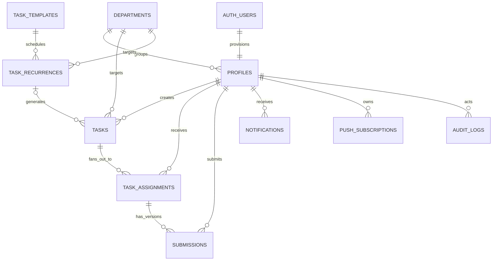

# Choture — Restaurant Task Management

A mobile-first restaurant operations PWA built with React, Vite, TypeScript, Tailwind CSS, Supabase, Firebase Cloud Messaging and Netlify. The browser UI uses real Supabase Auth and data operations; without credentials it displays setup guidance instead of fake task data.

## Included

- Responsive admin and employee dashboards with live assignment statistics, status/deadline filters, department and employee filters for admins, and loading/error/empty states.
- Admin team and department management, task review queue, employee completion progress, and Realtime dashboard refreshes for assignment and task changes.
- Admins can create employee Auth accounts directly with a required name, email, and initial password, then remove/restore sign-in access while preserving assignment and audit history. New accounts are always employees; role promotion remains an audited admin action. Employees can change their password in Profile & settings.
- User-first task assignment: search and select active employees by name or department, then configure and confirm the task before assignment. Department-wide selection fans out into an independent assignment and submission history for each employee.
- Admin task creation supports priorities, deadlines, one-time or daily/weekly/monthly schedules, checkbox/checklist, written response, camera photo, or combined checklist + text + photo requirements.
- Multi-part tasks let admins choose the exact combination of checklist/confirmation, written response, and camera photo requirements. Employees can prepare multiple assignments together and submit them in one transaction; admins can select and approve multiple eligible submissions together.
- Phone navigation uses a top-left menu instead of a fixed bottom navigation bar. Task completion actions stay visible in the mobile detail sheet.
- Camera evidence is captured with `getUserMedia` only, uploaded as JPEG to the private `task-evidence` bucket, and shown through short-lived signed previews after Storage authorization.
- Dedicated admin-only pending-approval queue with secure photo previews, approve/reject controls, required rejection reasons, employee resubmission history, audit timelines and review notifications.
- Private evidence bucket with camera capture via `getUserMedia`; no gallery picker or file upload path is offered. The camera captures in the browser; the resulting JPEG is uploaded to private Supabase Storage after the employee submits.
- Per-user in-app notifications via Supabase Realtime, with optional Firebase browser push and an in-app-only fallback when permission or Firebase setup is unavailable.
- SQL migrations with RLS, private checked workflow implementations, owner-only first-admin bootstrap, audited role/profile management, indexes and seed departments.
- Supabase Auth session restoration, inactive-profile sign-out, email/password login and URL-based role routing (`/admin/*`, `/employee/*`).
- Installable PWA shell, offline fallback, responsive admin and employee pages, Netlify SPA routing.

## Local setup

Requirements: Node.js 20.19+ (Vite 8) and npm. The database is provisioned by the migrations in `supabase/migrations`. Link the Supabase CLI and run `npx supabase db push --remote --include-seed` to apply unapplied migrations and safe department seeds. Create the first user in Supabase Auth, then run this one-time owner-only bootstrap from Supabase SQL Editor:

```sql
select private.bootstrap_initial_admin('owner@yourrestaurant.com');
```

Copy `.env.example` to `.env.local`, add `VITE_SUPABASE_URL` and `VITE_SUPABASE_ANON_KEY`, then run:

```sh
npm install
npm run dev
```

Use only the Supabase anon/publishable key in the browser. Never use a service-role key in a `VITE_` variable. Restrict production Auth settings to your site origins and use HTTPS.

## Supabase setup

The database migrations are additive and are not run automatically by the web app. This repository has been initialized and linked to the `restaurant-task-manager` Supabase project. Migrations `202611110001` through `202611110015` and the safe department seed have been applied to that project. Migration `202611110016` adds selectable multi-part proof requirements and atomic bulk submission/approval RPCs; it must be applied before deploying these UI changes.

1. For this linked project, use `npx supabase db push --remote --include-seed` after `npx supabase login`. For a fresh project, link it first with `npx supabase link --project-ref <project-ref>`. To apply through SQL Editor instead, run `supabase/migrations/*.sql` in filename order. If earlier migrations are already applied, run only unapplied later migrations. Do not run the initial migration over an existing schema; it creates tables and enum types.
2. Run `supabase/seed.sql` to add only the four example departments. It creates no fake staff or admin accounts.
3. Set Auth email/password policy and disable public signups. Active admins create employees through the trusted `provision-team-member` Edge Function, which creates confirmed Auth accounts server-side and never grants admin on creation. The Auth trigger creates an EMPLOYEE profile.
4. Create the first Auth user, then run `select private.bootstrap_initial_admin('email-address')` as the database owner. It succeeds only if no active admin exists and the email belongs to an active employee profile. Subsequent role, department and active-state changes use the audited `manage_profile` RPC and admin workspace. Direct client updates to profile roles are revoked. New Auth users always receive EMPLOYEE; disable hosted public sign-up under Authentication settings and create staff through Team & access.
5. The migrations add `profiles`, `task_assignments`, `tasks`, and `notifications` to the Realtime publication when it exists. RLS limits visible events to rows the user is allowed to read.
6. The migration creates or hardens the private `task-evidence` bucket with a 5 MB JPEG cap. Photo object paths are stored in submissions; the bucket has no public-read policy.

Local Supabase Auth disables self-signup and requires 12-character mixed-case alphanumeric passwords. In the hosted Dashboard, also enable leaked-password protection; the current Security Advisor reports this Auth setting is disabled. Email confirmation and custom SMTP settings are controlled separately in the project Dashboard.

Run `npm run test:rls` while logged into the Supabase CLI to execute read-only privilege and policy assertions against the linked project. It creates no users or database rows. Unit tests cover role routing and the complete assignment state transition matrix; the RLS assertions check deployed table policies, review-function guards, audit/notification writes and role/function grants. No production test users are created.

### Schema and relationships

The second migration preserves legacy columns used by the current app while adding the requested canonical column names. The app's current role, submission type, and status enum values are uppercase (`ADMIN`, `EMPLOYEE`, `CHECKBOX`/`TEXT`/`CAMERA`/`MULTIPLE`, and `ASSIGNED`/`IN_PROGRESS`/`PENDING_APPROVAL`/`COMPLETED`/`REJECTED`).



The user-first workflow uses `create_user_first_task` as its client task creation path. It verifies the caller is an active admin and validates each selected active employee before creating one assignment per person. Combined submissions store proof requirements in `tasks.submission_config`; each version's checked checklist values, text, and private photo path are recorded in its own `submissions` row. `submit_user_first_task` verifies the active assignment owner, state, checklist completion and required evidence before moving that assignment to review. The existing `review_task` requires an admin other than the assignee and only accepts a pending submission; rejection records a reason and permits another version. `(task_id, employee_id)` and the recurring instance key `(recurrence_id, recurrence_date)` prevent duplicate assignment and task instances.

### RLS policy review

- **Profiles:** users read only their own profile; admins can read/update team profiles. Signup trigger always writes EMPLOYEE.
- **Tasks:** employees read only tasks with their own assignment; admins read all and can update/archive. Clients cannot insert tasks directly.
- **Assignments:** owner and admins can read. There are no direct client insert/update/delete policies; checked RPCs control assignment and workflow changes.
- **Submissions:** employee and admins can read; no direct insert/update/delete policy. Each resubmission is a separate history row.
- **Notifications:** recipient can read and change only read-state columns, enforced by both RLS and column grants.
- **Departments, templates, recurrences:** authenticated users can read departments; only admins mutate departments, templates or recurrence rules.
- **Push subscriptions:** user can access only their own subscription rows.
- **Audit logs:** admin read-only through RLS; writes happen inside privileged RPCs.
- **Storage:** private bucket; employee upload is limited to their active CAMERA or MULTIPLE assignment path. Reads are limited to that employee or an admin. The SQL submission function verifies the JPEG object exists before accepting its path.

The migration review found no direct employee write policy on assignments/submissions and no employee review path. Public RPCs are invoker-only wrappers that call checked implementations in the unexposed `private` schema; the admin role helper uses the same pattern. Trigger helpers are invoker-only and not callable via the API. It cannot inspect policies created manually in your Supabase project; before production, review **Database → Policies** for any extra broad policies on these tables or `storage.objects`, especially policies granting `anon` or all authenticated users unrestricted reads/writes.

## Recurring tasks and templates

The schema supports daily, weekly and monthly recurrence in the selected IANA time zone. The first task instance is created with the assignment, and a unique `(recurrence_id, recurrence_date)` index plus a locked generation function prevents duplicates. Weekly schedules follow the start weekday; monthly schedules use the same day, or the last day in shorter months. The `generate-recurring-tasks` Edge Function verifies `x-cron-secret` and uses the service-role key only inside the server function.

The linked project has the function deployed, `pg_cron`/`pg_net` enabled, and a Vault-backed job invoking it every 15 minutes. The signing key is stored in Edge Function secrets and Supabase Vault; only a short-lived HMAC signature enters the `pg_net` request queue. Check runs in Supabase **Database → Cron Jobs**. Recurrence management controls are not exposed in the admin UI yet; recurring rules are created with tasks through the task form.

## Firebase web push

The in-app notification center subscribes to the recipient's Supabase Realtime rows and remains available without Firebase. To enable browser push, register a Firebase web app, enable Cloud Messaging, generate a Web Push VAPID key, and set all six `VITE_FIREBASE_*` values in `.env.local` (or Netlify). The values are public web-app configuration. The app injects that config into the registered root service worker URL; `public/sw.js` keeps the PWA shell and imports `public/firebase-messaging-sw.js` only when Firebase is configured. Users opt in from Profile after an explicit click. Denied permission is not prompted again; unsupported browsers and missing Firebase config retain in-app alerts and Realtime.

The `send-push` Edge Function is deployed behind a timestamped HMAC signed with `NOTIFICATION_WEBHOOK_SECRET`. The database notification trigger invokes it; the key itself is not sent in the request. The function verifies the signature, re-reads the notification, and sends a data-only message to every device token owned by that recipient. Data-only payloads let the shared root worker display one background notification; foreground messages reconcile the same notification row received over Realtime. `FIREBASE_SERVICE_ACCOUNT_JSON` must be set as a Supabase Edge Function secret. Never put it in Vite variables or frontend files. Migration `202611110014_fcm_token_ownership_and_deadline_reminders.sql` enforces globally unique device tokens and creates idempotent 24-hour deadline reminders; it has been applied to the linked project. Until the browser settings and server service account are configured, in-app notifications continue normally and FCM delivery is inactive.

Admin employee account creation uses the authenticated `provision-team-member` Edge Function. Deploy it with `npx supabase functions deploy provision-team-member`; it checks the caller's active `profiles` role and uses the server-side Auth Admin API to create an email-confirmed employee with the admin-provided initial password. Share that password securely; employees can change it after sign-in in Profile & settings. New accounts are always `EMPLOYEE`. **Remove access** deactivates the profile instead of deleting the Auth user, preserving task, submission, and audit records.

Token rows are scoped to `auth.uid()` by RLS, and a global unique index prevents one device token from being attached to multiple users. A user can register multiple device tokens. Sign-out deletes the current browser token under the user's own RLS scope before signing out; token refresh is reconciled on app load and when the browser returns to the foreground. If the browser is denied notification permission, it keeps Realtime and the in-app notification center active.

## Deployment

### Netlify

Import the repository into Netlify. The checked-in `netlify.toml` sets `npm run build`, publishes `dist`, applies SPA routing, and configures camera and security headers. Set these site environment variables before deploying:

- Required: `VITE_SUPABASE_URL`, `VITE_SUPABASE_ANON_KEY`.
- Optional for browser push: `VITE_FIREBASE_API_KEY`, `VITE_FIREBASE_AUTH_DOMAIN`, `VITE_FIREBASE_PROJECT_ID`, `VITE_FIREBASE_MESSAGING_SENDER_ID`, `VITE_FIREBASE_APP_ID`, `VITE_FIREBASE_VAPID_KEY`.

Do not edit `public/firebase-messaging-sw.js` with credentials; public browser config is passed at worker registration. Never add a Supabase service-role key or Firebase service account to Netlify's `VITE_*` variables. Set `FIREBASE_SERVICE_ACCOUNT_JSON` only in Supabase Edge Function secrets. In Supabase Auth URL Configuration, set the production Netlify URL as Site URL and add the production and local development callback URLs. Keep public signups disabled and provision employee accounts through Supabase Auth.

### PWA

The checked-in `public/manifest.json` and `public/sw.js` define the installable app and offline shell. The worker caches same-origin static assets only; it does not cache Supabase/auth/storage API responses, so employees cannot submit or admins cannot review while offline. Install from the browser menu on Android/desktop Chrome or use **Share → Add to Home Screen** in iOS Safari. The camera requires HTTPS (localhost is allowed for development) and a user gesture. Replace the starter SVG and PNG icons with approved restaurant branding as needed.

### Current readiness snapshot

As of 2026-11-11, migrations through `202611110015` are applied to the linked Supabase project. Migration `202611110016` is pending and is required for selectable proof configurations and grouped submit/review actions. Firebase browser values are present in the local environment, but the Firebase service-account secret is absent from Supabase Edge Function secrets, so live FCM delivery cannot be verified yet. The Netlify configuration is ready, but no Netlify site has been linked or deployed. Browser push requires HTTPS and a supported browser; physical iOS/Android push, multi-device delivery, and authenticated admin/employee push targeting still require Firebase server credentials and real device accounts to verify.

## Development checks

```sh
npm run typecheck
npm run lint
npm test
npm run build
npm run audit:production
npm run test:rls
```

After applying migration `202611110014`, verify FCM token isolation and the reminder schedule with `npx supabase db query --remote --read-only --file tests/fcm_access.sql`.

## Known limitations and costs

Supabase, Firebase, and Netlify free plans have changing quotas, storage, bandwidth, inactivity, and feature limits; they are not unlimited or guaranteed free. Review each provider's current pricing and backups before relying on the app for operations. Task template management and recurrence management UI are not exposed yet. Employee-wise report aggregation remains future work. The production build passes but reports a main JavaScript chunk above 500 KB before gzip (about 159 KB gzipped); further route-level code splitting would reduce that warning. There is no service-role key or Firebase private key in the frontend.
